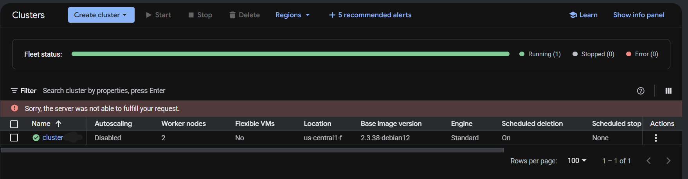
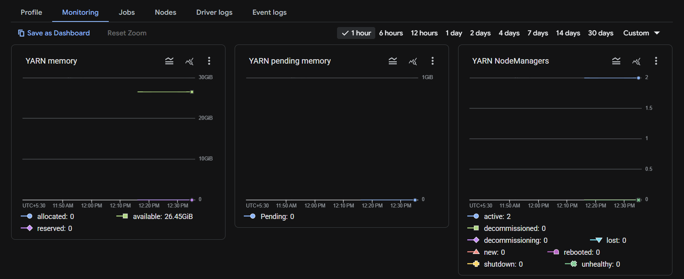
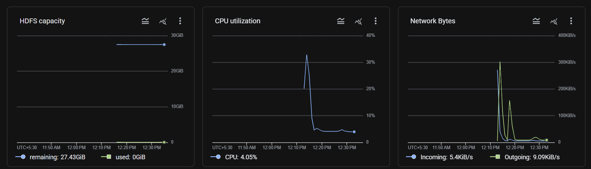
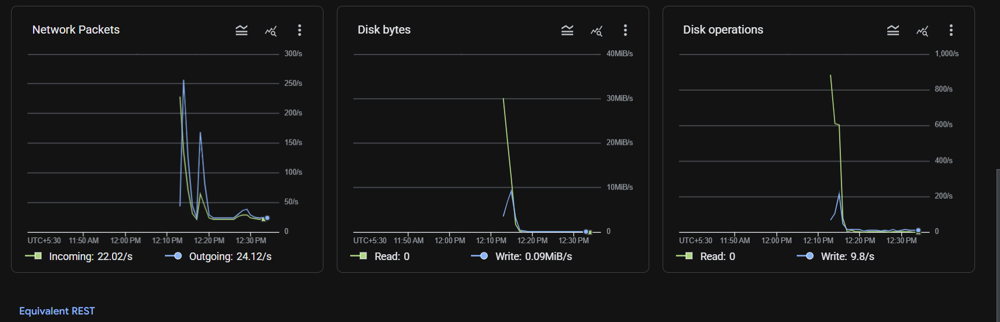
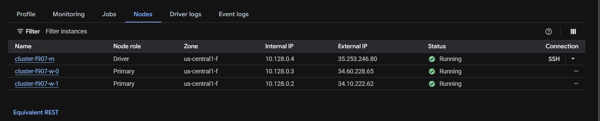
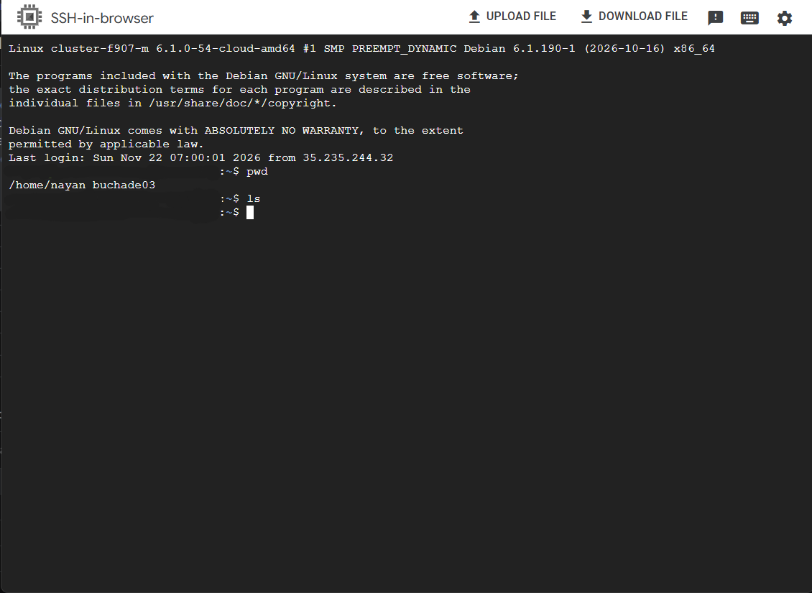
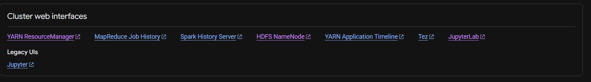
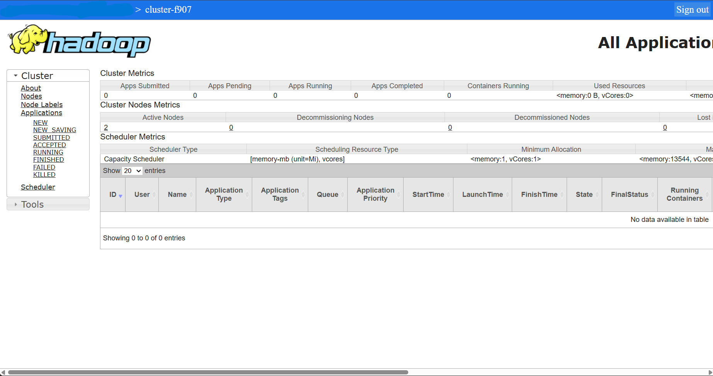
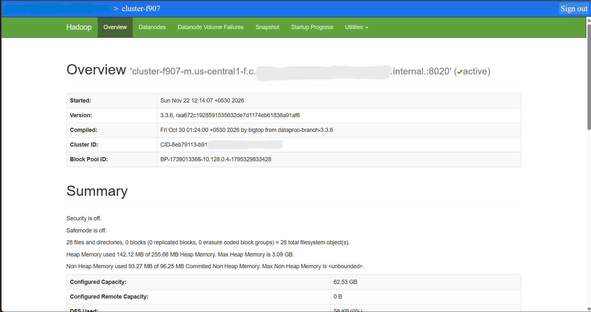
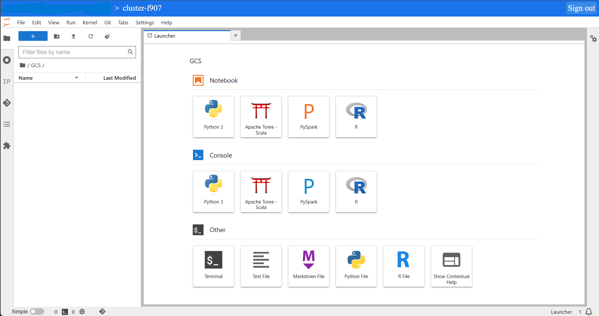

# GCP Dataproc: Cluster Architecture, IAM & Operations Walkthrough

A hands-on lab documenting how to provision, secure, monitor, and interact with a cost-optimized **Standard Apache Spark cluster** (1 driver, 2 workers) on Google Cloud Dataproc (Managed Service for Apache Spark).

---

## 1. Cost-Optimized Cluster Setup

Default Dataproc UI settings spin up oversized VMs with 32 GB SSDs (~$0.49/hr) that burn through free credits and hit regional vCPU quotas. I configured a multi-node Standard cluster tuned for prolonged learning:

* **Cluster Shape:** Standard (1 Master/Driver + 2 Workers) in `us-central1`
* **Compute:** `e2-medium` (2 vCPUs, 4 GB RAM per node — 6 vCPUs total, safely under free-trial limits)
* **Storage:** 32 GB Standard Persistent Disk (`pd-standard`)
* **Cost Controls:** Disabled Lightning Engine and enabled **1-Hr idle auto-deletion**
* **Networking:** Enabled **Component Gateway** for secure browser access to cluster UIs

---

## 2. IAM & Provisioning Troubleshooting

Setting up the cluster from scratch highlighted GCP's **Control Plane vs. Data Plane** security model:

1. **BigLake Metastore Error (Control Plane):** The Dataproc Service Agent attempted to attach a default Lakehouse Iceberg catalog while the BigLake API was disabled. *Fix:* Unchecked **Iceberg REST Endpoint** under Metastore configuration to run a clean Spark cluster.
2. **Missing `dataproc.agents.create` Error (Data Plane):** Because new GCP projects follow the Principle of Least Privilege, the default Compute Engine service account (`<PROJECT_NUMBER>-compute@developer.gserviceaccount.com`) lacked permissions for the Dataproc agent to register and lease tasks. *Fix:* Granted the tightly scoped **Dataproc Worker** (`roles/dataproc.worker`) role in IAM.

---

## 3. Exploring the Running Cluster

### Cluster Lifecycle (Start / Stop Dashboard)
Managing cluster state directly from the Dataproc dashboard. Stopping a cluster pauses VM compute billing while preserving the configuration, whereas persistent disks continue incurring minor storage costs until the cluster is deleted—reinforcing why data should live in GCS rather than cluster HDFS.



### Monitoring
Explored the built-in Cloud Monitoring metrics for Dataproc, focusing on **YARN Memory**, **YARN Pending/Available Containers**, **HDFS Storage Utilization**, and **CPU usage** to understand how to spot resource bottlenecks or idle clusters.





### Nodes (Master & Worker VMs)
Inspected the underlying Compute Engine VM instances provisioned by Dataproc—separating the **Master (Driver) node** (`-m`) that coordinates YARN/Spark from the **Worker nodes** (`-w-0`, `-w-1`) that execute distributed tasks.



### SSH & CLI Access
Connected directly into the Master node via browser SSH to explore the Linux environment, inspect cluster configurations, and see how jobs and HDFS commands (`hdfs dfs`, `spark-submit`) can be executed directly from the terminal.



### Web Interfaces (Component Gateway)
Used Dataproc's **Component Gateway** to access internal Hadoop, Spark web UIs and Jupyter Labs over HTTPS without opening public firewall ports or manually configuring SSH SOCKS proxies.



### YARN ResourceManager
Navigated the YARN UI to inspect cluster-wide compute capacity (total memory and vCores across workers), active nodes, scheduler queues, and application execution status.



### Hadoop DataNode
Launched **Hadoop DataNode** through the Component Gateway to interact with the DataNodes and its utilities.



### JupyterLab
Launched **JupyterLab** through the Component Gateway to run interactive PySpark sessions directly against the managed cluster rather than a single local machine.



---

## 4. Reproducible Setup (`gcloud` CLI)

```bash
gcloud dataproc clusters create cluster-standard \
  --region=us-central1 \
  --image-version=2.3-debian12 \
  --master-machine-type=e2-medium \
  --master-boot-disk-size=30GB \
  --master-boot-disk-type=pd-standard \
  --num-workers=2 \
  --worker-machine-type=e2-medium \
  --worker-boot-disk-size=30GB \
  --worker-boot-disk-type=pd-standard \
  --enable-component-gateway \
  --optional-components=JUPYTER \
  --max-idle=30m
```

---

## 5. Key Takeaways

* **Ephemeral Compute, Persistent Storage:** Dataproc clusters are meant to be spun up for jobs and torn down when idle; datasets and scripts belong in Google Cloud Storage (`gs://`).
* **Least-Privilege IAM:** Cluster VMs authenticate to GCP services using their attached **Compute Service Account**, not the user's personal login.
* **Observability Matters:** Combining the **Monitoring** tab with the **YARN ResourceManager** gives full visibility into whether a Spark job is actually utilizing worker nodes or hitting memory limits.